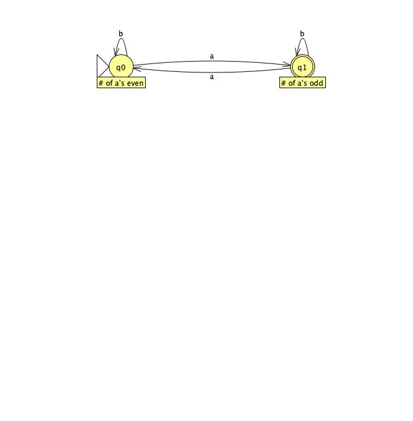
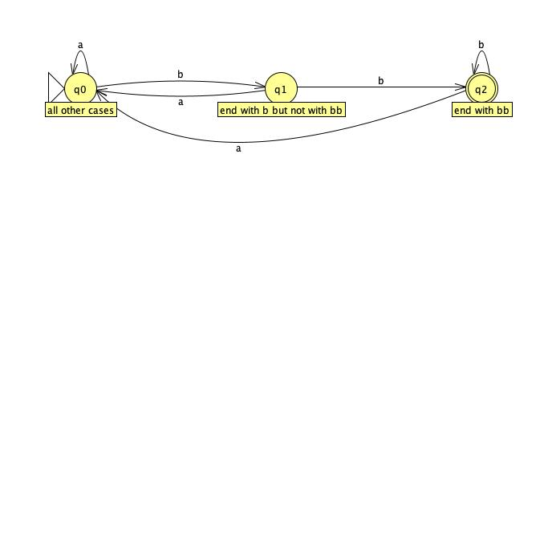
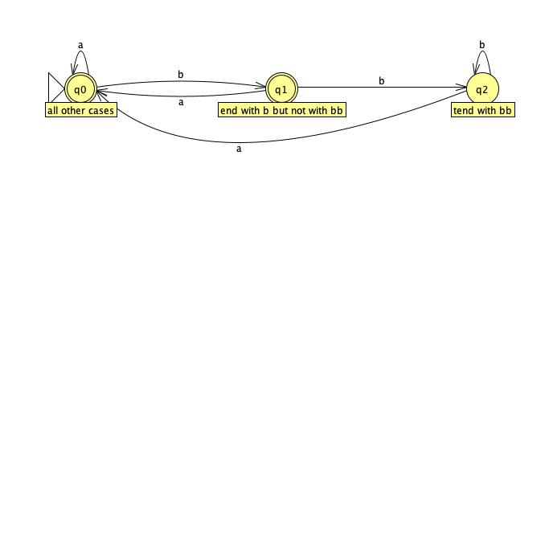
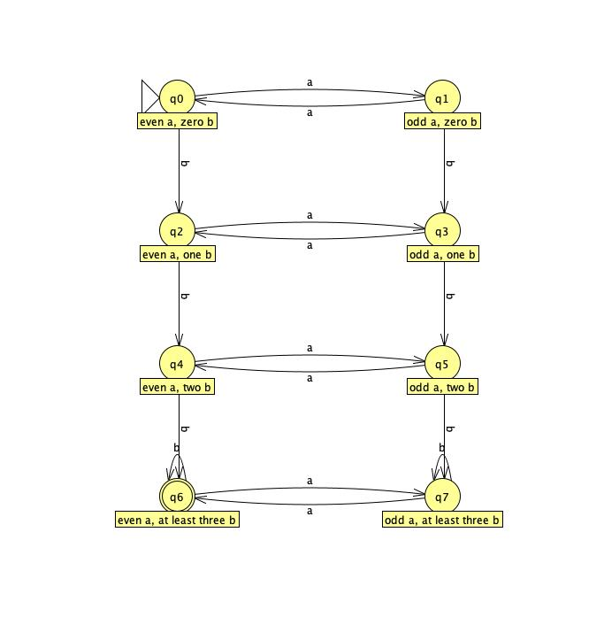
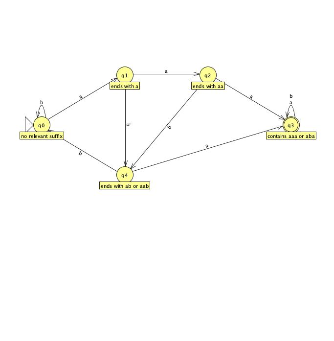
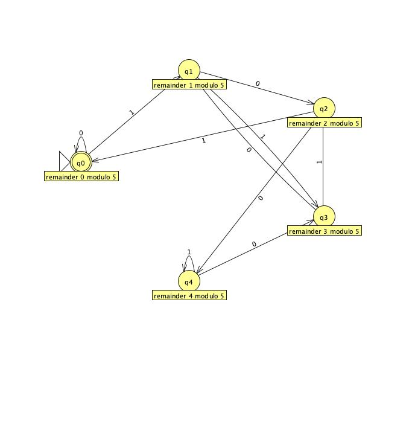
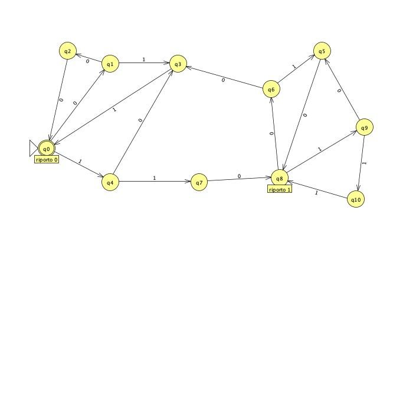

# DFA Construction Exercises

## Part 1: Alphabet $\Sigma = \{a, b\}$

Design a Deterministic Finite Automaton (DFA) that recognizes each of the following languages:

### Exercise 1

Strings with an odd number of `a`s.

* **Accepted (YES):** `a`, `aaba`, `bbaaab`
* **Rejected (NO):** $\epsilon$, `aa`, `baba`

Show DFA

### Exercise 2

Strings that end with `bb`.

* **Accepted (YES):** `bb`, `abb`, `bababb`
* **Rejected (NO):** $\epsilon$, `b`, `bba`

Show DFA

### Exercise 3

Strings that do not end with `bb`.

* **Accepted (YES):** $\epsilon$, `b`, `bba`
* **Rejected (NO):** `bb`, `abb`, `bababb`

Show DFA

### Exercise 4

Strings with an even number of `a`s and at least three `b`s.

* **Accepted (YES):** `bbb`, `bababb`, `bbbaa`
* **Rejected (NO):** $\epsilon$, `bbaa`, `bababa`

Show DFA

### Exercise 5

Strings that contain the substring `aaa` or the substring `aba` (must contain at least one of the two).

* **Accepted (YES):** `babab`, `aaaa`, `aaaba`
* **Rejected (NO):** $\epsilon$, `abba`, `bbaa`

Show DFA

## Part 2: Alphabet $\Sigma = \{0, 1\}$

### Exercise 6

Design a DFA that recognizes strings which, when interpreted as a binary number, result in a multiple of 5.

* **Accepted (YES):** `0` *(0)*, `101` *(5)*, `1010` *(10)*
* **Rejected (NO):** `1` *(1)*, `110` *(6)*, `111` *(7)*

Show DFA

## Homework Assignment

Using the alphabet $\Sigma = \{0, 1\}$, design a DFA that verifies the correctness of binary additions.

Given an input string formatted as interleaved bits:

$$
a_0 b_0 c_0 a_1 b_1 c_1 \dots a_n b_n c_n
$$

The DFA must check if:

$$
a_n \dots a_1 a_0 + b_n \dots b_1 b_0 = c_n \dots c_1 c_0
$$

*(i.e., verify that* $a + b = c$*, where* $a, b,$ *and* $c$ *are binary numbers of the same length, read from the least significant bit to the most significant bit).*

* **Accepted (YES):** 
  * `000` *(0+0=0)*
  * `110001` *(1+1=2, read as 01+01=10)*
  * `011101` *(2+1=3, read as 01+10=11)*
* **Rejected (NO):** 
  * `001` *(0+0!=1)*
  * `111` *(1+1!=1)*
  * `100` *(1+0!=0)*

Show DFA

> Note: in a complete version of the DFA, the dead state should be placed at the bottom of the diagram as a separate node toward which all invalid transitions converge. In practice, it represents the situation in which the DFA has encountered a bit pattern that can no longer satisfy the equality a + b = c. In this graphical version, it has been omitted to keep the diagram cleaner.