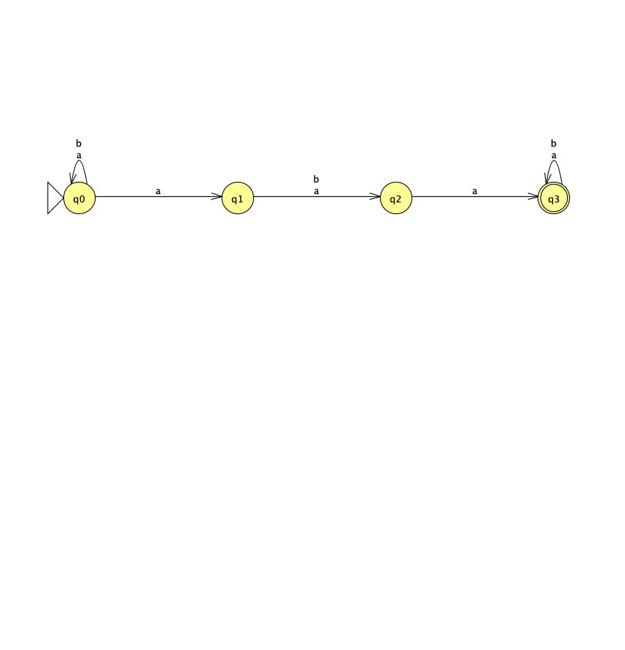
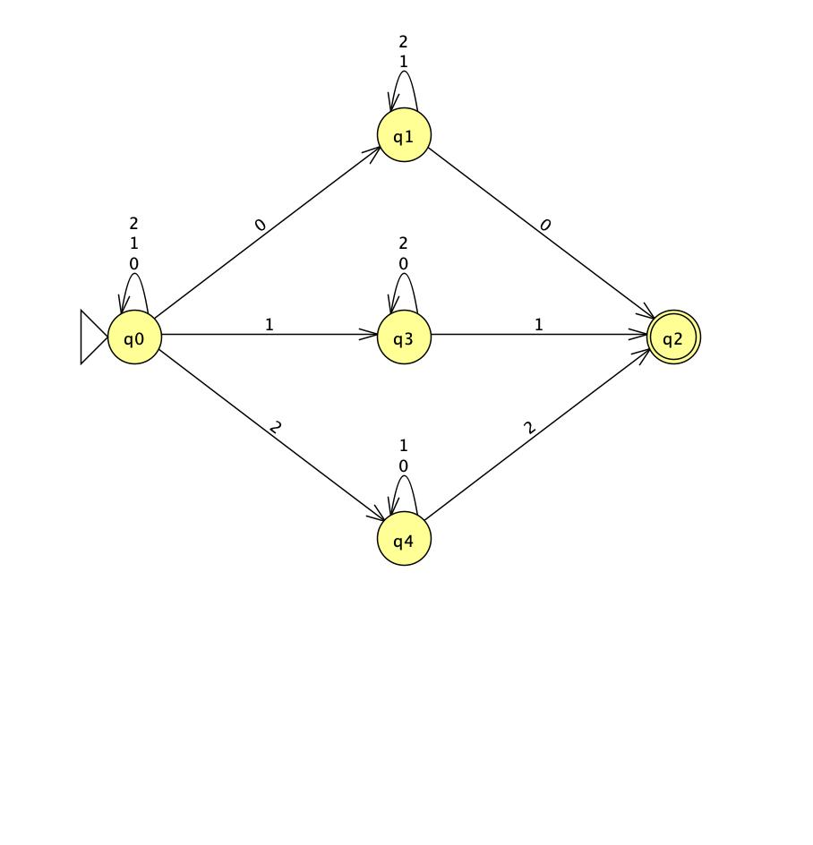
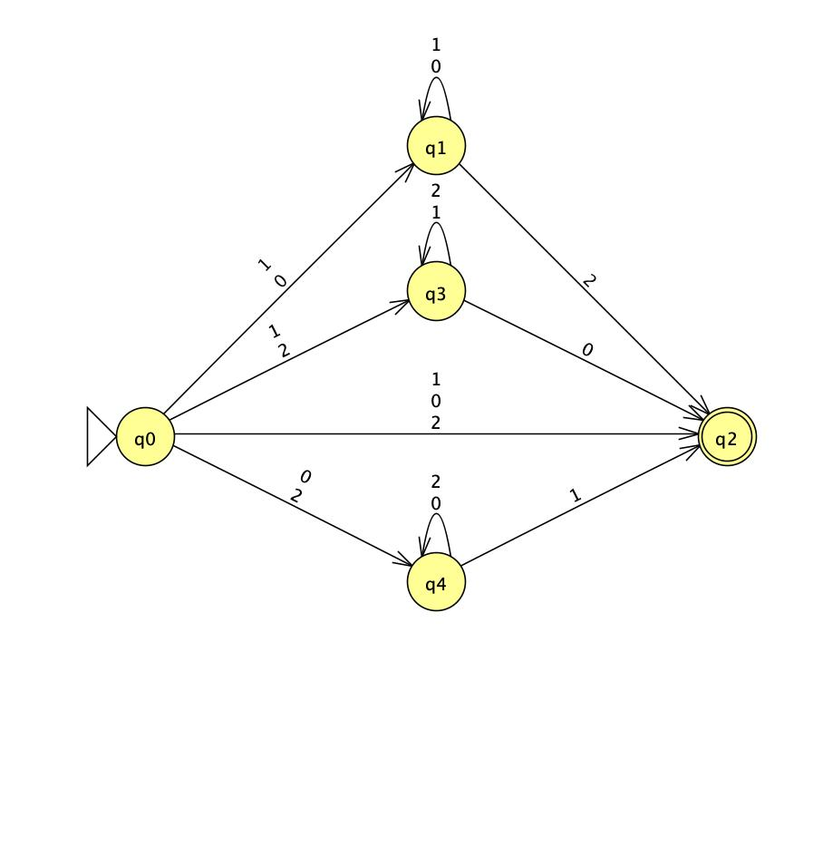
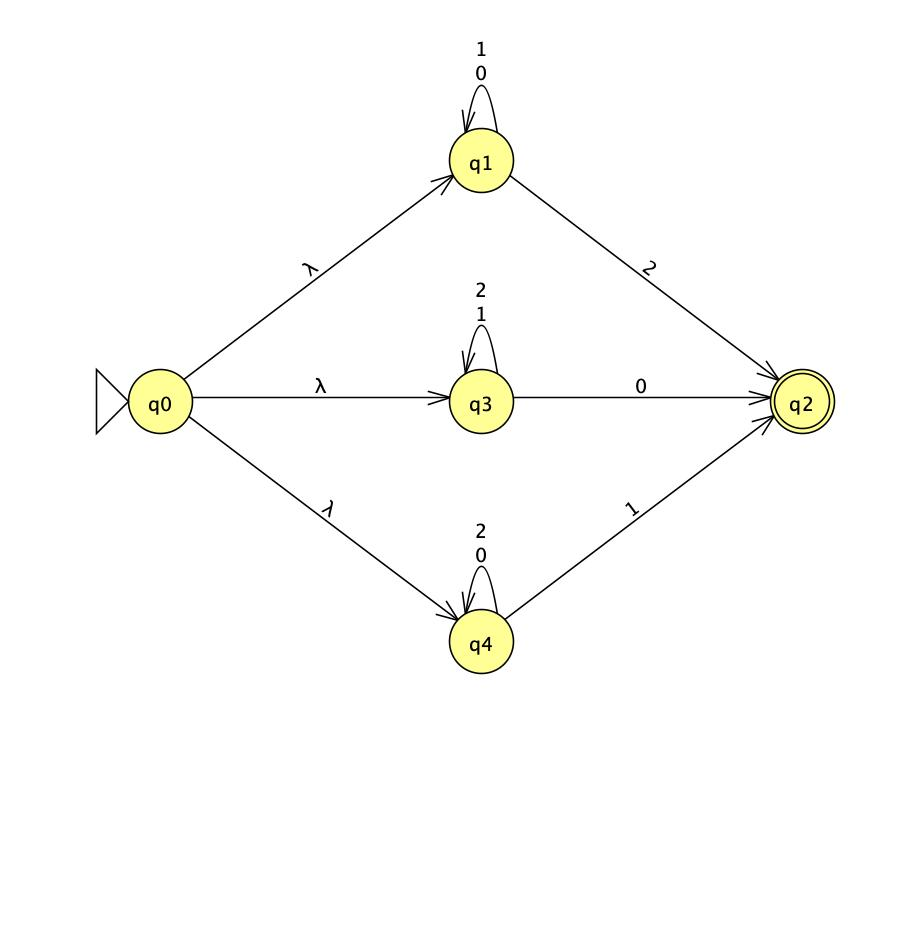
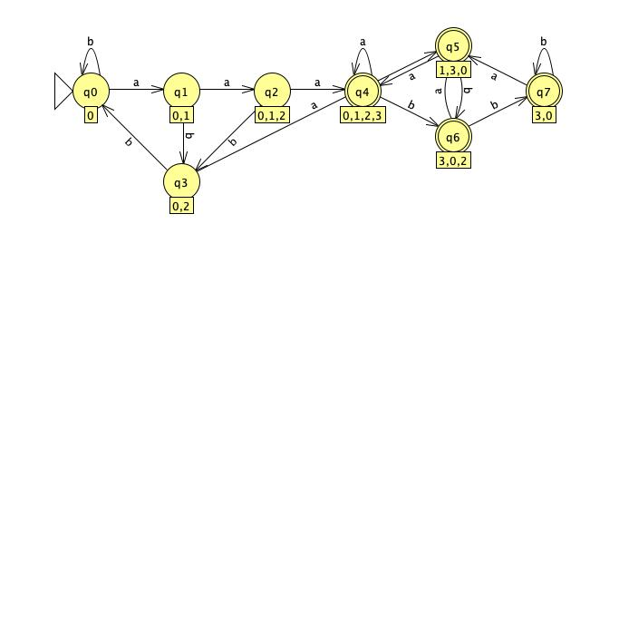
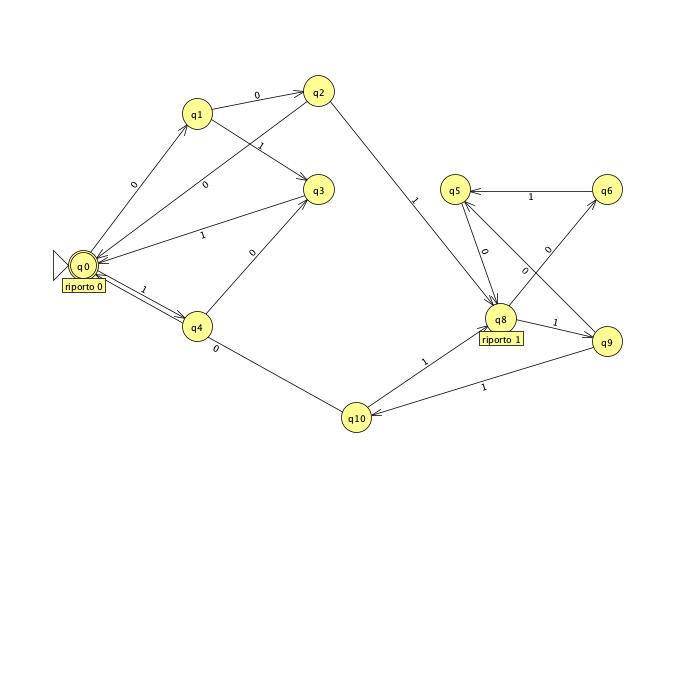
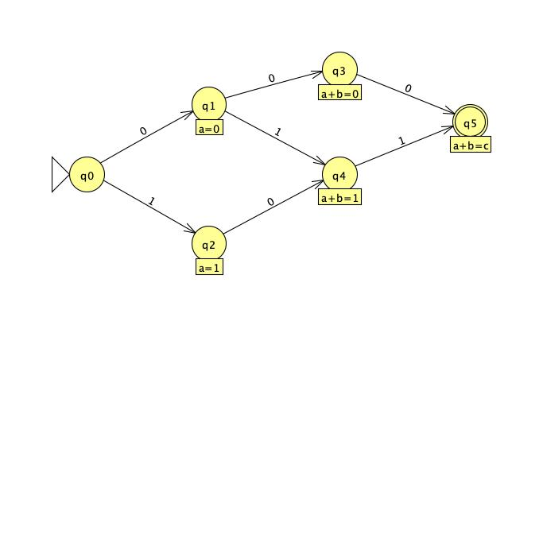

# NFA Construction Exercises

## Part 1: NFA Construction

### Exercise 1

Given the alphabet $\Sigma = \{a, b\}$, build an NFA that recognizes strings containing either `aaa` or `aba` as a substring.

* **Accepted (YES):** `babab`, `aaaa`, `aaaba`, `aaba`
* **Rejected (NO):** $\epsilon$, `abba`, `a`, `b`, `ab`

Show NFA

### Exercise 2

Build an NFA over the alphabet $\Sigma = \{0, 1, 2\}$ that recognizes all non-empty strings in which the last symbol appears at least once earlier in the string.

* **Accepted (YES):** `011`, `121`, `22`, `0120`
* **Rejected (NO):** $\epsilon$, `012`, `20`, `1`

Show NFA

### Exercise 3

Build an NFA over the alphabet $\Sigma = \{0, 1, 2\}$ that recognizes all non-empty strings in which the last symbol does not appear earlier in the string.

* **Accepted (YES):** `012`, `20`, `1`
* **Rejected (NO):** $\epsilon$, `011`, `121`, `22`, `0120`

Show NFA

### Exercise 4

Build an $\epsilon$-NFA over the alphabet $\Sigma = \{0, 1, 2\}$ that recognizes the same language as Exercise 3, using epsilon transitions.

* **Accepted (YES):** `012`, `20`, `1`
* **Rejected (NO):** $\epsilon$, `011`, `121`, `22`, `0120`

Show $\epsilon$-NFA

### Exercise 5

Given the alphabet $\Sigma = \{a, b\}$, transform the NFA from Exercise 1 into an equivalent DFA.

* **Accepted (YES):** `babab`, `aaaa`, `aaaba`, `aaba`
* **Rejected (NO):** $\epsilon$, `abba`, `a`, `b`, `ab`

Show DFA

## Homework Assignment

In both exercises, use the alphabet $\Sigma = \{0, 1\}$ and consider binary
numbers of the same length:

$$
a_n \dots a_0 + b_n \dots b_0 = c_n \dots c_0.
$$

Determine whether a DFA can recognize the set of encodings that represent
correct additions. Justify your answer by considering the order in which the
bits are read and the amount of memory required to propagate carries or
compare the corresponding bits.

### Exercise 1

The input is given with the three corresponding bits interleaved, starting
with the most significant position:

$$
a_n b_n c_n \dots a_0 b_0 c_0.
$$

Show DFA

### Exercise 2

The input is given in three consecutive blocks, starting with the least
significant position:

$$
a_0 \dots a_n\; b_0 \dots b_n\; c_0 \dots c_n.
$$

Show DFA

